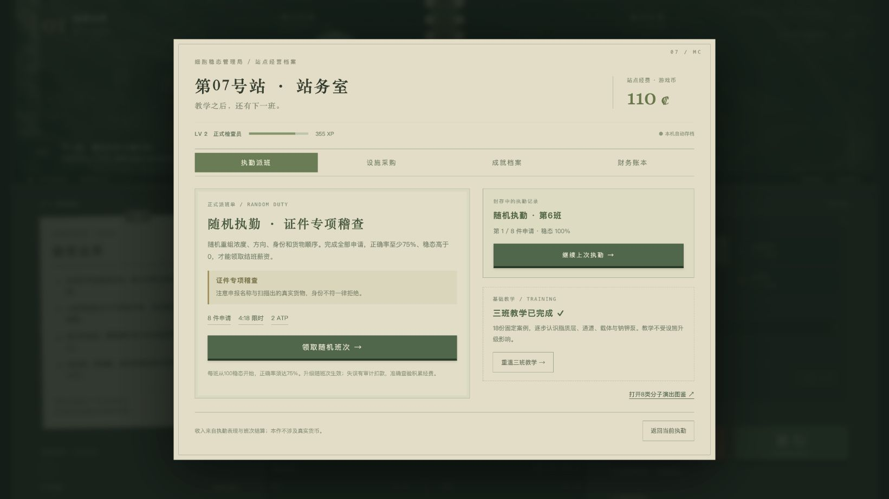

# 细胞膜边检站 · Membrane Checkpoint

原创中文生物学习游戏。坐在细胞膜的边检窗口，扫描物质、测量梯度、核验证件，选择运输路线与蛋白端口，再盖章放行或拒绝。

**[立即试玩](https://meiosis7.github.io/cell-membrane-checkpoint/)** · **[分子演出图鉴](https://meiosis7.github.io/cell-membrane-checkpoint/theatre.html)** · **[离线版与版本存档](https://github.com/Meiosis7/cell-membrane-checkpoint/releases/latest)**

## v1.2.3 自适应演出与检查台

- 三班教学、18件申请；教学后解锁持续生成的随机执勤。
- 8类专属运输演出，含水通道、GLUT载体和3Na⁺/2K⁺泵循环。
- 5种随机事件、经费与经验、永久设施、应急修复、12项成就。
- 桌面检查台按内容高度排布，规定、证件、查验、运输配置和盖章同时可见；演出区使用剩余高度，恢复较大的场景；裁决反馈独立占位。
- 自动保存、继续执勤、暂停、声音开关及窄屏布局。
- 全部为游戏币；存档保存在当前浏览器与当前网址，无账号或云同步。



## 操作

1. 扫描货物（1）并测量梯度（2）。
2. 核对真实身份、运输方向、驱动力与当班规定。
3. 选择运输路线、蛋白端口及必要的ATP，点击放行或拒绝。
4. 查看解释与演出，按空格或“下一位”继续。

Esc暂停；手册、简报、反馈、站务室与暂停期间均不计时。

## 本机运行与检查

不需要安装第三方依赖。在仓库根目录运行：

```sh
python3 -m http.server 5187 --bind 127.0.0.1
```

浏览器访问 http://127.0.0.1:5187/ 。本机入口仅在服务运行时可用。也可从 Release 下载已内嵌资源的独立HTML。

```sh
npm test
python3 scripts/build_site.py
```

测试需要 Node.js 22 或更新版本；构建只需 Python 3。GitHub Actions 在测试通过后将静态网页发布到 GitHub Pages。

## 文件与说明

`core.js`负责运输裁决，`career.js`负责随机班次、经费、成就与档案，`office.js`负责站务室，`stage.js`负责分子形态与演出，`app.js`连接界面与状态。

- [完整使用说明](docs/使用说明.md)
- [科学依据与模型边界](docs/科学依据.md)
- [随机执勤与经营设计](docs/经营设计.md)
- [素材来源与演出设计](docs/素材与演出说明.md)

本作是示意性学习游戏，细胞没有真实的边检审批制度。玩法受《Papers, Please》的窗口查验体验启发；未使用其商业美术、文本或音频。AI生成装饰性显微背景；分子、数量、方向、运输机构与动作由程序控制。全部解释以游戏手册及科学边界说明为准。
